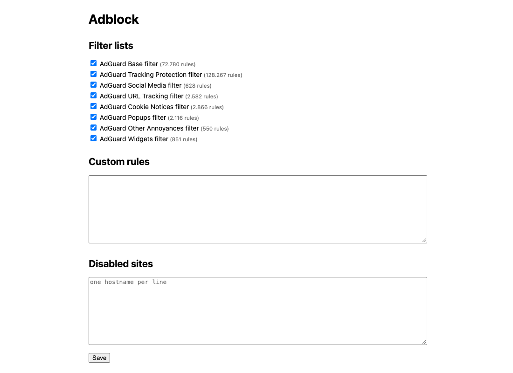

# adblock

[](https://github.com/felixx-dbm/adblock/actions/workflows/ci.yml)

A Manifest V3 Chrome extension that blocks ads and trackers as thoroughly as MV3 allows, built on AdGuard's open-source filter engine.

## Why

Since Chrome dropped Manifest V2, blocking `webRequest` is gone and extensions like uBlock Origin no longer run in their full form. This project explores how far you can get with what MV3 still offers: `declarativeNetRequest` for the network layer, plus cosmetic filtering and scriptlets for everything DNR cannot do.

## Features

- **Network blocking** via static DNR rulesets compiled from AdGuard lists (ads, privacy, annoyances, language lists)
- **Cosmetic filtering**: element hiding, extended/procedural CSS selectors, `MutationObserver` for late-loaded ads
- **Scriptlets** injected into the page's main world before page scripts run, including YouTube ad pruning
- **YouTube fallback**: auto-skip, and mute plus 16x playback for unskippable ads
- **Element picker** to hide anything with a click, saved as a custom rule
- **Per-site toggle**, allowlist and custom rules (parsed with AGTree, converted to dynamic DNR rules)
- **Blocked counter** per tab on the badge
- Daily cosmetic list updates; the engine is cached in storage so it survives service worker restarts

## Architecture

```
build time                         runtime (Chrome MV3)
dnr-rulesets CLI -> rulesets/      service worker
esbuild -> dist/                     - static rulesets on/off
                                     - allowlist + custom rules -> dynamic DNR
                                     - blocked count, messaging, cosmetic engine
                                   content script (document_start)
                                     - CSS, extended CSS, observer
                                     - YouTube fallback, element picker
                                   scriptlets (MAIN world, injected by SW)
```

Design notes and trade-offs: [`docs/superpowers/specs`](docs/superpowers/specs/2026-10-08-adblock-extension-design.md).



## Install

Download `adblock-vX.Y.Z.zip` from the [latest release](https://github.com/felixx-dbm/adblock/releases/latest) and unzip it. Open `chrome://extensions`, enable Developer mode, click "Load unpacked" and select the unzipped folder.

Each release is built by CI with the filter lists current at that time.

## Build from source

```bash
npm install
npm run update-lists   # download and compile filter lists
npm run build          # outputs dist/
```

Open `chrome://extensions`, enable Developer mode, "Load unpacked", select `dist/`.

## Tests

```bash
npm test               # unit tests (Vitest + jsdom)
npm run test:e2e       # Playwright against a real Chromium with the extension loaded
```

## Limitations

- Network list updates need a rebuild, because MV3 static rulesets are fixed at install time.
- The blocked counter uses `onRuleMatchedDebug`, which only works for unpacked extensions.
- Not published to the Chrome Web Store.

## Stack

TypeScript (strict), esbuild, `@adguard/tsurlfilter`, `@adguard/dnr-converter`, `@adguard/extended-css`, `@adguard/agtree`, Vitest, Playwright.

## License

GPL-3.0, as required by the AdGuard libraries it builds on.
